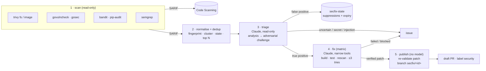

# secubot

A daily GitHub Actions pipeline that finds security issues with deterministic scanners,
has Claude check whether each one is actually exploitable, and opens **draft** pull
requests with verified fixes. Anything it can't fix with confidence becomes an issue for a
human. It never merges anything.



| Stage | What runs | Tokens it holds |
|---|---|---|
| **scan** | Pinned scanners → SARIF → Code Scanning; plain-code normaliser fingerprints, merges and dedups findings, drops what is suppressed or already in flight (`secfix/<id>` branch, PR, issue), keeps the top N | `GITHUB_TOKEN` read + `security-events: write` |
| **triage** | Claude Code, read-only tools (Read/Grep/Glob), two independent sessions: an analysis, then an adversarial review that tries to refute it. Code decides the outcome | Anthropic key, `contents: read` |
| **fix** | One job per cluster. Claude Code with Edit and an exact allowlist of Bash commands (build, test, rescan). secubot then re-runs build/test/rescan, validates the diff and retries with feedback (default max 3 attempts) | Anthropic key, `contents: read` |
| **publish** | No model, no repository code. Re-validates each patch, pushes `secfix/<id>`, opens a draft PR / issue, records suppressions | `contents/pull-requests/issues: write` |

Simple dependency bumps are left to Renovate/Dependabot by default. secubot only takes on
upgrades that break something (a major or 0.x minor bump), or vulnerable code that is
reachable and has no fixed version.

## Quick start

1. Add the `ANTHROPIC_API_KEY` secret to the target repository.
2. Under **Settings → Actions → General**, enable *Allow GitHub Actions to create and approve
   pull requests*. You can skip this if you use a GitHub App (see [onboarding](docs/onboarding.md)).
3. Add `.github/workflows/secfix.yml`:

```yaml
name: secfix
on:
  schedule: [{ cron: "23 3 * * *" }]
  workflow_dispatch:
permissions: {}
concurrency: { group: secfix, cancel-in-progress: false }
jobs:
  secfix:
    uses: YOUR_ORG/secubot/.github/workflows/secfix.yml@v1
    permissions: { contents: write, pull-requests: write, issues: write, security-events: write, actions: read }
    secrets:
      ANTHROPIC_API_KEY: ${{ secrets.ANTHROPIC_API_KEY }}
```

4. Optional: add a `.secfix.yml` with build/test commands
   ([annotated example](examples/target-repo/.secfix.yml)). Without them a fix is verified
   only by a rescan.
5. Run the workflow once by hand with `dry-run: true` and `egress-policy: audit` (pass them
   through `with:`). Check the job summaries. Then remove both.

## Documentation

| | |
|---|---|
| [Architecture](docs/architecture.md) | Stages, data flow, fingerprints and clusters, state and idempotency, the triage decision table, the fix loop |
| [Security model](docs/security.md) | Threat model, the controls in each layer, prompt-injection handling, residual risks |
| [Onboarding](docs/onboarding.md) | Secrets, repository settings, GitHub App, egress audit→block, GHAS, monorepo and cross-org variants, control plane |
| [Configuration](docs/configuration.md) | `.secfix.yml` reference and the reusable workflow's inputs/secrets |
| [Operations](docs/operations.md) | Releases and pinning, scanner upgrades, costs, troubleshooting, running locally |
| [Alternatives](docs/alternatives.md) | Claude Security, claude-code-action, OpenHands, Copilot Autofix, and when to use them instead |

## Repository layout

```
.github/workflows/secfix.yml        reusable workflow (workflow_call), the pipeline itself
.github/workflows/control-plane.yml optional: staggered dispatch + fleet dashboard
.github/actions/setup-secubot/      composite action: uv + secubot (+ bubblewrap for agents)
src/secubot/                        normaliser, state, triage, fix loop, publisher (Python, uv)
src/secubot/prompts/                system, triage (analyse/challenge) and fix prompts
scanners/                           pinned scanner versions + hash-locked requirements
scripts/                            install-scanners, lock-scanners, release
control-plane/fleet.yml             repositories driven by the control plane
examples/                           caller workflow + config for a repo and for a monorepo
tests/                              offline tests (fixtures, fake agent, local git remotes)
```

## Development

```bash
uv sync
uv run pytest
uv run ruff check src tests && uv run ruff format --check src tests
uv run secubot --help
```

The tests are offline. They use recorded SARIF fixtures, a scripted fake agent and a local
bare git remote, so no API key or network is needed.
