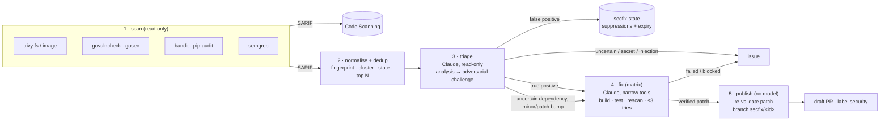

# secubot

A daily GitHub Actions pipeline that finds security issues with deterministic scanners,
has Claude check whether each one is actually exploitable, and opens **draft** pull
requests with verified fixes. Anything it can't fix with confidence becomes an issue for a
human. It never merges anything.



| Stage | What runs | Tokens it holds |
|---|---|---|
| **scan** | Pinned scanners → SARIF → Code Scanning; plain-code normaliser fingerprints, merges and dedups findings, drops what is suppressed or already in flight (`secfix/<id>` branch, PR, issue), keeps the top N | `GITHUB_TOKEN` read + `security-events: write` |
| **triage** | Claude Code, read-only tools (Read/Grep/Glob), two independent sessions: an analysis, then an adversarial review that tries to refute it. Code decides the outcome | Anthropic key, `contents: read` |
| **fix** | One job per cluster. Claude Code with Edit and an exact allowlist of Bash commands (build, test, rescan). secubot then re-runs build/test/rescan, validates the diff and retries with feedback (default max 3 attempts) | Anthropic key, `contents: read` |
| **publish** | No model, no repository code. Re-validates each patch, pushes `secfix/<id>`, opens a draft PR / issue, records suppressions | `contents/pull-requests/issues: write` |

Simple dependency bumps are left to Renovate/Dependabot by default. secubot only takes on
upgrades that break something (a major or 0.x minor bump), or vulnerable code that is
reachable and has no fixed version.

## Enable secubot on a repository

You need `gh` logged in with admin access to the repository, and an Anthropic API key,
ideally from a dedicated workspace with a monthly spend limit. Replace `OWNER/REPO` below.
In a fork of secubot, also replace `damhau/secubot` with yours.

**1. Add the API key as a secret** (`gh` prompts for it, so it never lands in your history):

```bash
gh secret set ANTHROPIC_API_KEY -R OWNER/REPO
```

**2. Allow GitHub Actions to open pull requests** (not needed with a GitHub App, see
[onboarding](docs/onboarding.md#3-github-app-for-publish-recommended)):

```bash
gh api -X PUT repos/OWNER/REPO/actions/permissions/workflow \
  -f default_workflow_permissions=read -F can_approve_pull_request_reviews=true
```

**3. Add the caller workflow** as `.github/workflows/secfix.yml`:

```yaml
name: secfix
on:
  workflow_dispatch:
  # schedule: [{ cron: "23 3 * * *" }] # step 7; pick a different time per repository
permissions: {}
concurrency: { group: secfix, cancel-in-progress: false }
jobs:
  secfix:
    uses: damhau/secubot/.github/workflows/secfix.yml@main
    permissions: { contents: write, pull-requests: write, issues: write, security-events: write, actions: read }
    with:
      secubot-repository: damhau/secubot
      secubot-ref: main # pin a release tag or SHA in step 7
      dry-run: true # removed in step 6
      egress-policy: audit # removed in step 7
    secrets:
      ANTHROPIC_API_KEY: ${{ secrets.ANTHROPIC_API_KEY }}
```

On a private repository without GitHub Code Security, add `code-scanning: false` under `with:`.

**4. Add `.secfix.yml`** at the repository root, so fixes are verified by your tests and not
only by a rescan ([all options](docs/configuration.md), [annotated
example](examples/target-repo/.secfix.yml)):

```yaml
version: 1
commands:
  setup: uv sync --frozen # Go: go mod download
  test: uv run pytest -q # Go: go test ./...
paths:
  ignore_protected: true # optional: leave GitHub Actions findings to Code Scanning
policy:
  max_prs: 1 # optional: a slow start
```

Routine dependency bumps are left to Dependabot or Renovate, so enable one of them. For
Dependabot, turn on security updates and add a
[`dependabot.yml`](examples/target-repo/.github/dependabot.yml):

```bash
gh api -X PUT repos/OWNER/REPO/vulnerability-alerts
gh api -X PUT repos/OWNER/REPO/automated-security-fixes
```

secubot then takes only the upgrades that break something and the code-level findings
([how the two split the work](docs/onboarding.md#dependabot--renovate)). On a repository
with neither tool, set `policy.dependencies: all` so secubot takes every bump. Commit and
push the files.

**5. Do a dry run** and watch it:

```bash
gh workflow run secfix.yml -R OWNER/REPO && sleep 5 && gh run watch -R OWNER/REPO
```

Nothing is pushed or opened. On the run page, the summary shows:

- *Handled this run*: each finding triaged, its verdict and what would happen (draft PR,
  issue, suppression). The reasoning is under *Triage reasoning*.
- *Not handled this run*: everything left alone, grouped by reason.

The patches are in the `secubot-fix-<id>` artifacts. A dry run of a small repository costs
about $1. Add `paths.skip` or `suppressions` to `.secfix.yml` for noise and run again.

**6. Go live**: delete the `dry-run: true` line, push, and run it again. You get draft PRs
labelled `security` on `secfix/<id>` branches, `[secfix:<id>]` issues for what needs a
human, and a `secfix-state` branch holding the suppressions. Nothing is ever merged
automatically. If an issue is a false positive, close it as **Not planned** with a comment
saying why: secubot leaves the finding alone for 180 days. When a finding goes away (a
merged Dependabot PR, a manual fix), the next run closes its secubot issue or PR.

**7. Run it daily**:

1. Uncomment `schedule:`.
2. After a few runs, look at the harden-runner section of each job log for the outbound
   connections, then delete `egress-policy: audit` so the default `block` applies.
3. Pin `@main` and `secubot-ref` to a release tag or SHA, so a secubot change reaches the
   repository only through a reviewed PR.

**To turn it off**, delete `.github/workflows/secfix.yml`. The `secfix/*` branches and
`secfix-state` can be deleted at any time.

## Documentation

| | |
|---|---|
| [Architecture](docs/architecture.md) | Stages, data flow, fingerprints and clusters, state and idempotency, the triage decision table, the fix loop |
| [Security model](docs/security.md) | Threat model, the controls in each layer, prompt-injection handling, residual risks |
| [Onboarding](docs/onboarding.md) | Secrets, repository settings, GitHub App, egress audit→block, GHAS, monorepo and cross-org variants, control plane |
| [Configuration](docs/configuration.md) | `.secfix.yml` reference and the reusable workflow's inputs/secrets |
| [Operations](docs/operations.md) | Releases and pinning, scanner upgrades, costs, troubleshooting, running locally |
| [Alternatives](docs/alternatives.md) | Claude Security, claude-code-action, OpenHands, Copilot Autofix, and when to use them instead |

## Repository layout

```
.github/workflows/secfix.yml        reusable workflow (workflow_call), the pipeline itself
.github/workflows/control-plane.yml optional: staggered dispatch + fleet dashboard
.github/actions/setup-secubot/      composite action: uv + secubot (+ bubblewrap for agents)
src/secubot/                        normaliser, state, triage, fix loop, publisher (Python, uv)
src/secubot/prompts/                system, triage (analyse/challenge) and fix prompts
scanners/                           pinned scanner versions + hash-locked requirements
scripts/                            install-scanners, lock-scanners, release
control-plane/fleet.yml             repositories driven by the control plane
examples/                           caller workflow + config for a repo and for a monorepo
tests/                              offline tests (fixtures, fake agent, local git remotes)
```

## Development

```bash
uv sync
uv run pytest
uv run ruff check src tests && uv run ruff format --check src tests
uv run secubot --help
```

The tests are offline. They use recorded SARIF fixtures, a scripted fake agent and a local
bare git remote, so no API key or network is needed.
