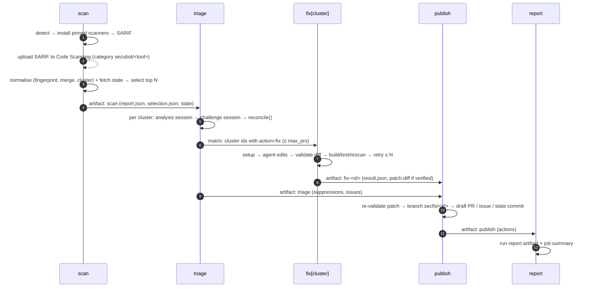

# Architecture

secubot is one reusable workflow (`.github/workflows/secfix.yml`) and a small Python
package (`src/secubot`) that every job installs from the same checked-out ref. Jobs
exchange data only through artifacts, so each one can be given exactly the permissions it
needs.



| Job | Permissions | Runs model | Runs repo code | Artifacts out |
|---|---|---|---|---|
| `scan` | `contents: read`, `security-events: write`, `actions: read`, `pull-requests: read`, `issues: read` | no | scanners only (parse, no build); `trivy-image` builds the Dockerfile | `secubot-sarif`, `secubot-scan` |
| `triage` | `contents: read` | yes, read-only tools | no | `secubot-triage` |
| `fix` (matrix) | `contents: read` | yes, Edit + allowlisted Bash | yes: setup/build/test, scrubbed env | `secubot-fix-<id>` |
| `publish` | `contents: write`, `pull-requests: write`, `issues: write` | no | no | `secubot-publish` |
| `report` | `contents: read` | no | no | `secubot-report` |

With the monorepo `instance` input, artifact names become `secubot<instance>-…`.

## 1. Scan

`secubot detect` picks the scanners from the repository's contents and `.secfix.yml`:

| Tool | When | Notes |
|---|---|---|
| trivy fs | always | dependencies, IaC misconfigurations, secrets. `--skip-version-check --disable-telemetry` |
| trivy image | `scanners.trivy_image.enabled` | `docker build`, then scan the image; results anchored on the Dockerfile |
| govulncheck | `go.mod` found | per module; gives **reachability** (whether the vulnerable symbol is called) |
| gosec | `go.mod` found | per module |
| bandit | Python project found | |
| pip-audit | Python project found | via `uv export` from `uv.lock` or from `requirements*.txt`. Fully pinned files are audited with `--no-deps --disable-pip`, so no package build scripts run. JSON is converted to SARIF (`secubot pip-audit-sarif`) |
| semgrep | always | `--metrics=off`, `scanners.semgrep.configs` (default `p/default`) |

The binaries are pinned in `scanners/versions.env`. Trivy is checked against a sha256, and
the Python tools are installed into separate venvs from hash-locked requirement files. A
scanner that fails does not fail the run: its status is recorded and shown in the job
summary and the fleet dashboard. Each SARIF file is uploaded to Code Scanning as-is, under
the category `secubot/<tool>`.

## 2. Normalise and dedup

This stage is plain code with no model involved (`sarif.py`, `normalise.py`).

1. **Parse** every SARIF run into `Finding`s. Each one gets a kind (code, dependency, iac,
   secret, license), a severity, CWE/CVE/GHSA/GO ids, and a repository-relative path with
   module prefixes rewritten.
   - Vulnerability ids come only from structured fields (rule id, name, short description,
     tags). Advisory text often mentions *other* CVEs, and reading those would wrongly
     merge advisories.
2. **Fingerprint**: `sha256(scheme, kind, vuln_key, path, anchor)`.
   - The *vuln key* is the CWE for code findings, and the primary CVE (or GHSA/GO id) for
     dependency findings.
   - The *anchor* is a hash of the whitespace-normalised source line rather than the line
     number, so findings survive unrelated edits above them. For secrets it is a hash, so
     the secret itself is never copied anywhere.
3. **Merge** findings that share a fingerprint, i.e. the same sink reported by different
   tools (gosec G204 + semgrep → one finding with two sources).
   - Dependency findings from one manifest directory and package that share any
     vulnerability id are merged too (trivy's CVE-X with govulncheck's GO-Y aliasing
     CVE-X).
   - When advisories merge, the fixed version kept is the highest one.
4. **Cluster** into the unit of work:
   - code: one location
   - dependency: one package per manifest directory, all advisories together, with a
     target version that fixes all of them and a `breaking_upgrade` flag
   - IaC: one cluster per file (tools word the same misconfiguration differently)
   - image: one cluster per image

   The cluster id is `sha256(cluster key)[:12]`. It is stable across runs, so it is used as
   the branch name `secfix/<id>`, the issue tag `[secfix:<id>]` and the suppression key.
5. **Select** (`state.py`). Each cluster is dropped when it matches the first applicable
   rule below:
   - its kind is not in `policy.kinds`
   - its severity is below `policy.min_severity`
   - it is covered by an active suppression
   - its issue was closed as *not planned* within `dismissed_ttl_days` (a dismissal, see
     below)
   - branch `secfix/<id>` exists (**the idempotency key**)
   - it has an open PR
   - it has a PR closed unmerged within `cooldown_days`
   - it has an open issue, or an issue closed within `cooldown_days`
   - it is a dependency that govulncheck proved unreachable
   - it is a dependency bump that Renovate/Dependabot should handle (`policy.dependencies`)

   The remaining clusters are ranked by severity, then reachability, then kind
   (code first), and the first `policy.max_triage` are kept.

State is fetched read-only by the scan job:

- remote `secfix/*` branches
- PRs whose head is `secfix/*`
- issues titled `[secfix:…]`, with why they were closed (`stateReason`) and their comments
- `suppressions.yml` on the orphan branch `secfix-state`

Nothing has to be stored anywhere else. Deleting the `secfix-state` branch resets the
automatic suppressions.

**Dismissals.** Closing a secubot issue as *Not planned* is how a human confirms a false
positive or accepts a risk. Select treats the cluster as suppressed for
`policy.dismissed_ttl_days` (180) from the close date, then examines it again. Only users
with triage access or more can close the issue, and GitHub records who did, so this is
safe on public repositories. The reason shown in the summary is the latest comment on the
issue by its owner, an organisation member or a collaborator. Comments by anyone else and
by bots are ignored. Nothing is written to `secfix-state`: the issue is the record, and
reopening it lifts the dismissal. A dismissal applies before the cool-down, so the summary
says *dismissed in issue #N* rather than *cool-down*.

## 3. Triage

Each selected cluster gets two **fresh** Claude Code sessions with read-only tools
(Read/Grep/Glob, no Bash, no Edit). Both answer in a JSON schema.

1. **Analysis** (`prompts/triage_analyse.md`): is this exploitable in this codebase? It
   follows the data from source to sink, checks reachability and existing mitigations,
   and cites files and lines for every claim. The verdict is `true_positive`,
   `false_positive` or `uncertain`, with a confidence and a fix plan.
2. **Challenge** (`prompts/triage_challenge.md`): a reviewer that sees the analysis and is
   told to refute it, arguing the other way. It can uphold the analysis or revise the
   verdict.

`triage.reconcile()` turns the two answers into an action deterministically:

| Analysis vs. challenge | Final verdict |
|---|---|
| Challenge does not hold (a "holds" that repeats the analysis's verdict counts as not holding) | the analysis verdict |
| Challenge holds and revises to TP with high confidence | true positive |
| Challenge holds otherwise | uncertain |

| Final verdict | Action |
|---|---|
| Either pass flags suspected prompt injection | **issue** (whatever the verdict) |
| TP, kind `secret` | **issue**: rotate first (a human job) |
| TP | **fix** |
| FP, `auto_suppress` on, severity ≤ `auto_suppress_max_severity` | **suppress** for `suppression_ttl_days`, with the reasoning as the reason |
| FP otherwise | **issue** asking a human to confirm |
| uncertain, kind `dependency`, non-breaking upgrade to a fixed version, `bump_uncertain_dependencies` on | **fix**: a verified bump is cheaper than proving reachability |
| uncertain otherwise | **issue** |

The rule throughout is that disagreement goes to a human, except for that one case: a
minor or patch bump is still a draft PR that must pass build, test and rescan. Suppressions always expire, so a
wrong one is re-examined within 30 days by default.

## 4. Fix

There is one matrix job per cluster with `action=fix`, capped at `policy.max_prs`. True
positives over the cap are *deferred*: no branch is created, so they are selected again on
the next run.

```
setup (scrubbed env) ─▶ agent turn ─▶ blocked/injection? ─▶ stop: blocked → issue
                           ▲                  │
                           │                  ▼
                retry prompt with      diff + validate_patch()  ── rejected ──┐
                problems + output             │                              │
                           │                  ▼                              │
                           └─── failed ── build ▸ test ▸ rescan ◀────────────┘
                                              │ all pass
                                              ▼
                                   patch.diff + result.json
```

- **Tools.** Read/Grep/Glob, Edit (Write only with `fix.allow_new_files`), and Bash
  limited to an exact allowlist: the configured `build` and `test` commands,
  `secubot recheck`, `fix.extra_commands`, and for dependency clusters `go get:*` /
  `go mod tidy` / `uv lock:*`. A `prefix:*` entry matches by prefix and refuses shell
  metacharacters.
- **The prompt** (`prompts/fix.md`) gives the triage reasoning and fix plan, the finding as
  data inside `<untrusted>` tags, the commands, and limits on files and lines changed. It
  asks for the smallest change that removes the vulnerability and keeps behaviour.
- **`secubot recheck`** re-runs only the cluster's scanners and says whether the finding is
  gone, so the agent can check its own work.
- **Verification is done by secubot**, not the agent, after every turn:
  1. Take the working tree diff.
  2. Run `validate_patch` (below).
  3. Run `build`.
  4. Run `test`.
  5. Rescan with the cluster's tools. The cluster's fingerprints must be gone. For code
     findings, each tool/rule must also be reported fewer times in that file than before,
     so rewriting the flagged line doesn't count as a fix. For dependencies, none of the
     cluster's vulnerability ids may remain.
- **Retries.** On failure, the problems and the tail of the failing output go back into
  the *same* session (`prompts/fix_retry.md`), up to `fix.max_attempts` (default 3). The
  result is `fixed`, `failed` (becomes an issue that links the attempts), `blocked` (the
  agent declined with a reason, or suspected injection; becomes an issue) or `error`.

`validate_patch` rejects:

- empty diffs
- paths outside the repository
- protected paths, built-in and configured
- sensitive paths (auth/crypto/session) when the finding is not located there
- deletions, binary changes, symlinks, submodules, mode changes, renames
- new files unless allowed
- diffs over `max_changed_files` / `max_changed_lines`
- anything that looks like a credential, or that contains the value of a token present in
  the environment

## 5. Publish

Publish is the only job with write access. It runs no model and no repository code.

1. Re-run `validate_patch` on each `patch.diff`. A rejected patch becomes an issue, never a
   branch.
2. If `secfix/<id>` already exists on the remote, skip it. This is the idempotency check
   again, in case another run raced this one.
3. Check out the scanned commit (`base_sha`). Then `git apply --check` and `git apply
   --index`, and commit with hooks disabled under the bot identity, with no co-author
   trailers.
4. Push `HEAD:refs/heads/secfix/<id>` and run `gh pr create --draft --label security`.
   The PR body contains the finding, the exploitability reasoning (analysis and challenge),
   the changes, the verification output for each step, the cost and a link to the run.
   Every string that came from a model or a scanner is sanitised first: no @mentions, no
   issue references, no HTML, no links or images, no bidi controls, and fences cannot be
   closed early.
5. Open issues for uncertain or failed clusters. Issues are deduplicated by the
   `[secfix:<id>]` title tag.
6. Commit new suppressions to `secfix-state` with git plumbing. Expired entries are
   dropped, and nothing is written when nothing changed.

Publish runs serially for a repository (`concurrency: secfix-publish-<repo>`). PRs are
always drafts and are never merged automatically. The ordinary review and CI of the
repository decide. With a GitHub App configured, the PRs are opened with the App's token,
so the repository's own CI runs on them (PRs opened with `GITHUB_TOKEN` don't trigger
workflows).

## Run report and fleet

The `report` job writes `run-report.json` (schema 1) as the `secubot-report` artifact. It
holds the totals by severity, the triage and fix outcomes, cost, actions and scanner
status. The optional control plane (`fleet.py`, `control-plane.yml`):

- dispatches each repository in its own hourly slot (`sha256(repo) mod slots`), which
  spreads API spend and runner load over the day
- collects the latest run reports into a markdown dashboard

See [onboarding](onboarding.md#control-plane-optional).

## Module map

| Module | Responsibility |
|---|---|
| `models.py` | Finding, Cluster, ScanReport, Severity, Kind, Reachability |
| `config.py` | `.secfix.yml` schema (strict), protected/sensitive defaults, language detection |
| `scanners.py`, `pip_audit.py` | run scanners with a scrubbed env, merge per-module SARIF, pip-audit → SARIF |
| `sarif.py`, `normalise.py` | parse, fingerprint, merge, cluster, version logic |
| `state.py` | state model, suppressions, selection |
| `agent.py`, `gate.py` | hardened Claude Agent SDK options; PreToolUse gate |
| `prompts/` | prompts and the `<untrusted>` wrapping |
| `triage.py` | two-pass triage + decision table |
| `fix.py`, `patch.py` | fix loop, verification, diff validation |
| `render.py`, `publish.py` | sanitised markdown; branches, PRs, issues, state commits |
| `report.py`, `fleet.py` | run report; control plane dispatch and dashboard |
| `cli.py` | `secubot <subcommand>`, one per workflow step |
